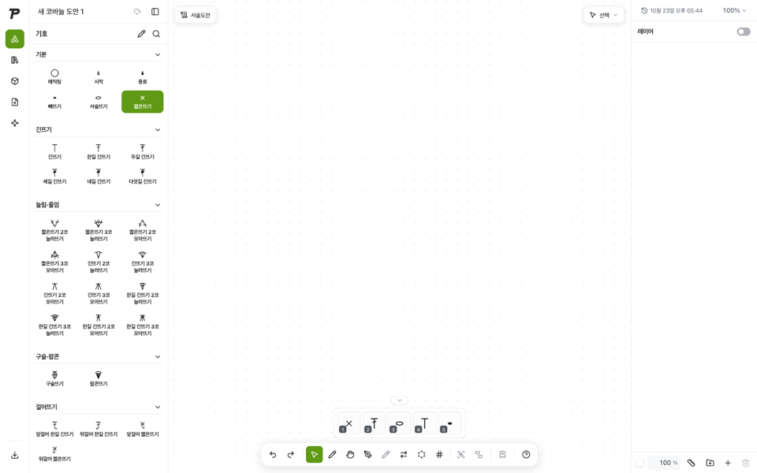
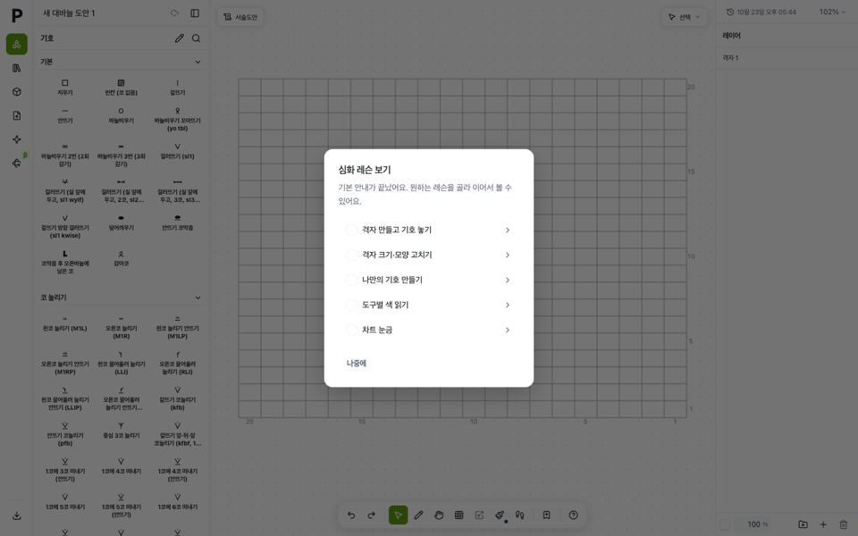
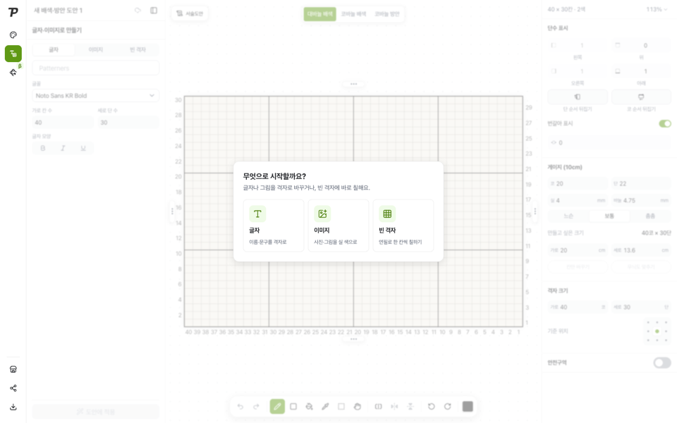
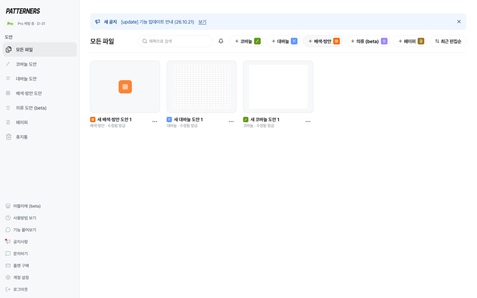

# patterners-clone

뜨개 도안 제작 서비스 [patterners.com](https://www.patterners.com/)의 화면과 편집기를 다시 만든 프로젝트입니다.
랜딩 페이지와, 그 안의 도안 편집 프로그램(코바늘·대바늘·배색/방안)을 담고 있어요.
원본 코드는 쓰지 않았고, 공개 화면과 화면 문구를 근거로 새로 작성했습니다.

## 실행

Node 24 이상.

```bash
npm install
npm run dev     # http://localhost:3100  (127.0.0.1 대신 localhost 권장)
npm run build && npm start
```

| 주소 | 화면 |
|---|---|
| `/` | 랜딩 페이지 |
| `/home` | 내 도안 (목록·새 도안·휴지통) |
| `/maker/<id>` | 도안 편집기 — 종류에 따라 코바늘 / 대바늘 / 배색·방안 |

도안은 브라우저 `localStorage`에 저장됩니다(계정·서버 없음).

## 편집기 기능

**코바늘** (화이트보드) — 기호 47종(기본·긴뜨기·구슬/팝콘·늘림/줄임·걸어뜨기·이랑뜨기·특수·도형), 기호 검색(초성 가능), 선택/삽입/이동/펜, 평면 만들기·원형 만들기(개수·크기 지정, 바깥 방향 회전), 늘려뜨기·모아뜨기로 합치기/바꾸기(오른쪽 클릭), 단 숫자 넣기, 퀵 슬롯 1–5, 레이어(단) 추가·이름·숨김·순서·색, 내 기호 등록, 회전·뒤집기·늘리기, 그룹, 복사/붙여넣기/복제, 단축키 도움말.

**대바늘** (격자 차트) — 격자 만들기(드래그·숫자), 격자 편집(가장자리 끌어 줄·열 추가/삭제), 기호 45종(교차 2–6코 너비 포함), 무늬 라이브러리 24종 찍기·채우기, 칸 색칠(붓·지우개·스포이트·올가미), 선택 영역 이동·복사·사방 핸들로 무늬 반복, 게이지에 맞춘 칸 비율·예상 완성 크기, 단수 표시(좌/우/번갈아·간격), 색별 코 수, 내 무늬 등록, 큰 격자는 canvas로 그림.

**배색·방안** — 시작 대화상자(글자→격자, 이미지→실 색 양자화·디더링·외톨이 점 정리, 빈 격자), 대바늘 배색 / 코바늘 배색 / 코바늘 방안 모드, 연필·사각형·채우기·스포이트·선택, 반전·90° 회전, 실 색 관리와 색별 코 수, 페이지, 게이지·완성 크기, 안전구역, 평면/원통·오른손/왼손 단 번호, 긴 걸침 검사.

공통 — 자동 저장(브라우저), 실행 취소/다시 실행, PNG·JPG·SVG 내보내기(단·코 번호, 범례 포함), 홈 썸네일.

## 구성

```
app/
  page.tsx            랜딩
  home/page.tsx       내 도안
  maker/[id]/page.tsx 편집기 진입 (종류별로 나눔)
  globals.css         Tailwind v4 + SEED 디자인 토큰, 브랜드 색(lime)
  landing.css         랜딩 전용 스타일
components/
  (랜딩) SiteHeader, Hero, Gallery, Features, Plans, Faq, SiteFooter, art.tsx(차트 그림)
  app/                편집기 공통: EditorShell(상단 막대), ui(버튼·대화상자·메뉴·토스트), icons
  editor/crochet/     코바늘 화이트보드 편집기
  editor/knitting/    대바늘 차트 편집기
  editor/grid/        배색·방안 편집기
lib/
  types.ts            도안 데이터 모델
  store.ts            localStorage 저장소(목록·복제·고정·휴지통 30일)
  useHistory.ts       실행 취소 / 다시 실행
  useAutosave.ts      자동 저장 + 썸네일
  export.ts           PNG·JPG·SVG 내보내기
  symbols/            코바늘·대바늘 기호 정의
scripts/gen-swatches.mjs  랜딩용 편물 자리표시 그림 생성
```

디자인 토큰은 [SEED Design](https://github.com/daangn/seed-design)(`@seed-design/css`, `@seed-design/tailwind4-theme`, Apache-2.0)을 쓰고, 브랜드 색만 lime 계열로 바꿨습니다.

## 원본과 다르게 둔 것 (자리표시)

저작권·개인정보 때문에 아래는 레포에 넣지 않고 자리표시로 바꿨어요. 실제 자료로 바꿀 위치를 함께 적습니다.

| 원본 | 이 레포 | 바꾸는 곳 |
|---|---|---|
| 로고 이미지 | 글자 워드마크 | `components/Wordmark.tsx` |
| 편물 사진 6장 (`swatch-*.webp`) | 코드로 그린 뜨개 질감 SVG | `public/landing/swatch-*.svg` (생성기: `node scripts/gen-swatches.mjs`) |
| 소개·튜토리얼 영상 | 캔버스 모양 자리표시 + 설명 문구 | `components/VideoSlot.tsx` — `src`에 mp4 경로를 주면 영상 재생 (`components/Sections.tsx`, `components/Features.tsx`의 `steps[].src`) |
| 사업자 정보·연락처·SNS 주소 | `{{COMPANY_NAME}}` 같은 자리표시 | `lib/site.ts` |

서버가 있어야 하는 기능(계정, 결제, 3D 실체화, AI 도안 변환, 아뜰리에 마켓, 공유 링크)은 넣지 않았습니다.

## 원본 대비 화면 대조 (랜딩)

원본은 자동화된 브라우저 접근을 막고 있어서, 받아 둔 원본 HTML과 공개 CSS를 로컬에서 그대로 띄운 화면을 기준으로 삼았습니다(원본 이미지 자리는 비어 보임).
같은 크기 창에서 찍어 픽셀 단위로 비교했습니다(pixelmatch, 임계값 0).

| 화면 | 같은 픽셀 | 비고 |
|---|---|---|
| 데스크톱 1440 전체(7004px) | 96.7% (정확히 같은 픽셀) | 섹션 위치·높이 완전 일치 |
| 모바일 390 전체 | 95.7% | 푸터만 18px 짧음(사업자 정보 자리표시가 짧아서) |

차이는 대부분 자리표시 이미지(스와치·로고)입니다.

| 원본(로컬 렌더) | 이 레포 |
|---|---|
|  |  |
|  |  |

<details><summary>데스크톱 전체 길이</summary>

| 원본 | 이 레포 |
|---|---|
|  |  |

</details>

## 편집기 화면 대조

원본 편집기(로그인 후 화면) 스크린샷·DOM 저장본을 기준으로, 같은 상태를 만들어 1440×900에서 찍고 REA `compare-web-screenshots`로 바뀐 픽셀 비율을 쟀습니다(채널 차이 8 이하 무시).

| 화면 | 처음 | 지금 |
|---|---|---|
| 홈(빈 상태) | 9.46% | 0.11% |
| 홈(새 도안 메뉴) | 9.35% | 0.11% |
| 코바늘 편집기(새 도안) | 61.7% | 0.21% |
| 코바늘 편집기(기호 선택) | 61.9% | 0.21% |
| 대바늘 편집기(새 도안 + 심화 레슨) | 95.8% | 1.77% |
| 대바늘 편집기(격자 고치기 레슨) | 85.9% | 0.95% |
| 배색·방안(시작 대화상자) | 93.6% | 0.07% |
| 배색·방안(이미지 탭) | 99.6% | 0.42% |

남은 차이는 직접 그린 기호 그림·로고(원본 이미지를 쓰지 않음), 격자 선 안티에일리어싱, 애니메이션 위상입니다.
기호 목록은 원본 번들을 REA로 분석해 묶음·순서·이름·높이를 맞췄습니다(코바늘 8묶음 42종, 대바늘 17묶음 328종). 기호 그림과 코드는 직접 작성했습니다.

| 코바늘 | 대바늘 | 배색·방안 | 홈 |
|---|---|---|---|
|  |  |  |  |

## 배포

Vercel 프로젝트 `chunbaenas-projects/patterners-clone` (Vercel 로그인 보호, 검색 노출 차단).

