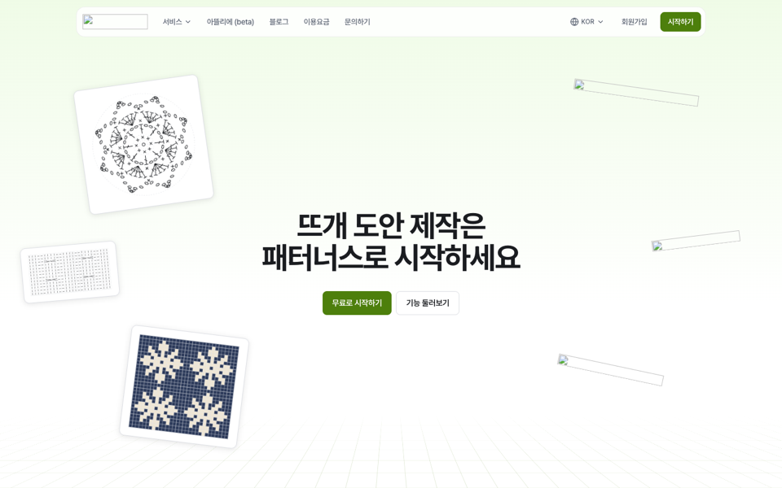
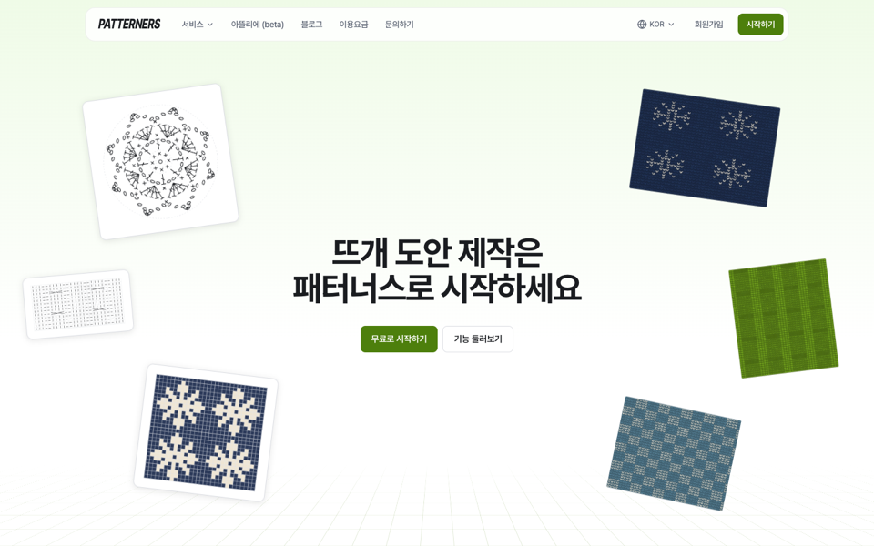
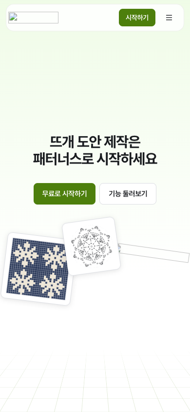
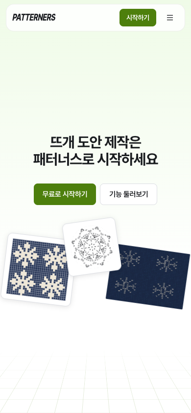
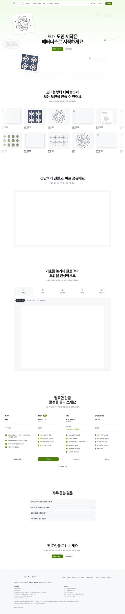
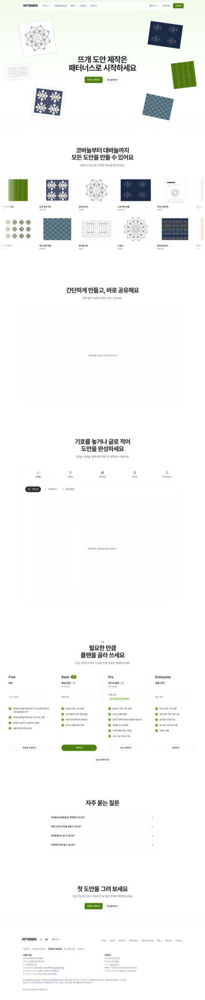

# patterners-clone

뜨개 도안 제작 서비스 [patterners.com](https://www.patterners.com/)의 화면과 편집기를 다시 만든 프로젝트입니다.
랜딩 페이지와, 그 안의 도안 편집 프로그램(코바늘·대바늘·배색/방안)을 담고 있어요.
원본 코드는 쓰지 않았고, 공개 화면과 화면 문구를 근거로 새로 작성했습니다.

## 실행

Node 24 이상.

```bash
npm install
npm run dev     # http://localhost:3100
npm run build && npm start
```

| 주소 | 화면 |
|---|---|
| `/` | 랜딩 페이지 |
| `/home` | 내 도안 (목록·새 도안·휴지통) |
| `/maker/<id>` | 도안 편집기 — 종류에 따라 코바늘 / 대바늘 / 배색·방안 |

도안은 브라우저 `localStorage`에 저장됩니다(계정·서버 없음).

## 구성

```
app/
  page.tsx            랜딩
  home/page.tsx       내 도안
  maker/[id]/page.tsx 편집기 진입 (종류별로 나눔)
  globals.css         Tailwind v4 + SEED 디자인 토큰, 브랜드 색(lime)
  landing.css         랜딩 전용 스타일
components/
  (랜딩) SiteHeader, Hero, Gallery, Features, Plans, Faq, SiteFooter, art.tsx(차트 그림)
  app/                편집기 공통: EditorShell(상단 막대), ui(버튼·대화상자·메뉴·토스트), icons
  editor/crochet/     코바늘 화이트보드 편집기
  editor/knitting/    대바늘 차트 편집기
  editor/grid/        배색·방안 편집기
lib/
  types.ts            도안 데이터 모델
  store.ts            localStorage 저장소(목록·복제·고정·휴지통 30일)
  useHistory.ts       실행 취소 / 다시 실행
  useAutosave.ts      자동 저장 + 썸네일
  export.ts           PNG·JPG·SVG 내보내기
  symbols/            코바늘·대바늘 기호 정의
scripts/gen-swatches.mjs  랜딩용 편물 자리표시 그림 생성
```

디자인 토큰은 [SEED Design](https://github.com/daangn/seed-design)(`@seed-design/css`, `@seed-design/tailwind4-theme`, Apache-2.0)을 쓰고, 브랜드 색만 lime 계열로 바꿨습니다.

## 원본과 다르게 둔 것 (자리표시)

저작권·개인정보 때문에 아래는 레포에 넣지 않고 자리표시로 바꿨어요. 실제 자료로 바꿀 위치를 함께 적습니다.

| 원본 | 이 레포 | 바꾸는 곳 |
|---|---|---|
| 로고 이미지 | 글자 워드마크 | `components/Wordmark.tsx` |
| 편물 사진 6장 (`swatch-*.webp`) | 코드로 그린 뜨개 질감 SVG | `public/landing/swatch-*.svg` (생성기: `node scripts/gen-swatches.mjs`) |
| 소개·튜토리얼 영상 | 캔버스 모양 자리표시 + 설명 문구 | `components/VideoSlot.tsx` — `src`에 mp4 경로를 주면 영상 재생 (`components/Sections.tsx`, `components/Features.tsx`의 `steps[].src`) |
| 사업자 정보·연락처·SNS 주소 | `{{COMPANY_NAME}}` 같은 자리표시 | `lib/site.ts` |

서버가 있어야 하는 기능(계정, 결제, 3D 실체화, AI 도안 변환, 아뜰리에 마켓, 공유 링크)은 넣지 않았습니다.

## 원본 대비 화면 대조 (랜딩)

원본은 자동화된 브라우저 접근을 막고 있어서, 받아 둔 원본 HTML과 공개 CSS를 로컬에서 그대로 띄운 화면을 기준으로 삼았습니다(원본 이미지 자리는 비어 보임).
같은 크기 창에서 찍어 픽셀 단위로 비교했습니다.

| 화면 | 같은 픽셀 | 비고 |
|---|---|---|
| 데스크톱 1440 전체(7004px) | 97.7% | 섹션 위치·높이 완전 일치 |
| 모바일 390 전체 | 97.0% | 푸터만 18px 짧음(사업자 정보 자리표시가 짧아서) |

차이는 대부분 자리표시 이미지(스와치·로고)입니다.

| 원본(로컬 렌더) | 이 레포 |
|---|---|
|  |  |
|  |  |

<details><summary>데스크톱 전체 길이</summary>

| 원본 | 이 레포 |
|---|---|
|  |  |

</details>
